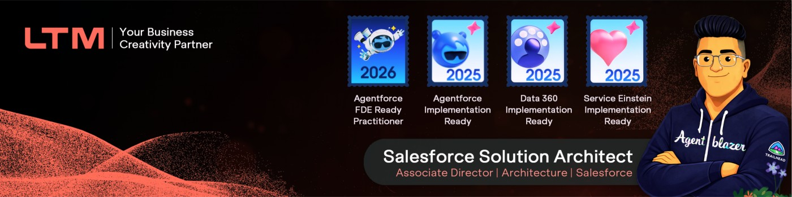
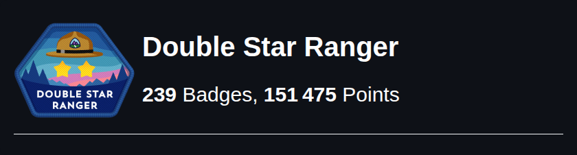

<!-- Header -->

  

  

  
  
  
  
  

##  Hi, I'm Abhishake

I'm an Associate Director in Salesforce Architecture at **LTM**, based in London. I've worked in CRM
for 15+ years, first on Siebel and now on Salesforce, and these days I spend most of my time on
**Agentforce** and **Data 360**. In my spare time I build small tools that make Salesforce delivery
a little easier.

- 🚀 &nbsp;Currently building **[Archistry](https://github.com/abhishakec/archistry)**
- 💬 &nbsp;Happy to talk Salesforce architecture, Agentforce and CRM delivery
- 🌍 &nbsp;English · Hindi · Bengali

## 🚀 Featured project: Archistry

  

  An AI-agent skill that turns a plain-language request into an editable <b>draw.io</b> diagram, 
  an interactive <b>HTML</b> page and <b>PNG / JPG / SVG</b> images, for Salesforce projects.

  
  
  

## 🧭 Domain knowledge

  
  
  
  
  

## ☁️ Salesforce

  

  

<b>Products</b>

  
  
   
  
   
  
  

## 🧰 Toolbox

<table align="center">
<tr>
<td align="right"><b>Programming</b></td>
<td>
  
  
  
  
  
  
  
</td>
</tr>
<tr>
<td align="right"><b>Tools</b></td>
<td>
  
  
  
  
  
  
  
  
</td>
</tr>
</table>

## 🐍 Contributions

  <picture>
    <source media="(prefers-color-scheme: dark)" srcset="https://raw.githubusercontent.com/abhishakec/abhishakec/output/snake-dark.svg" />
    
  </picture>

  

